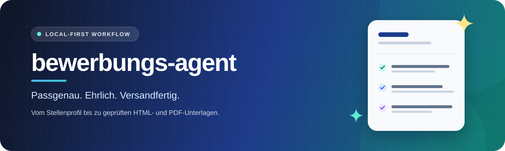
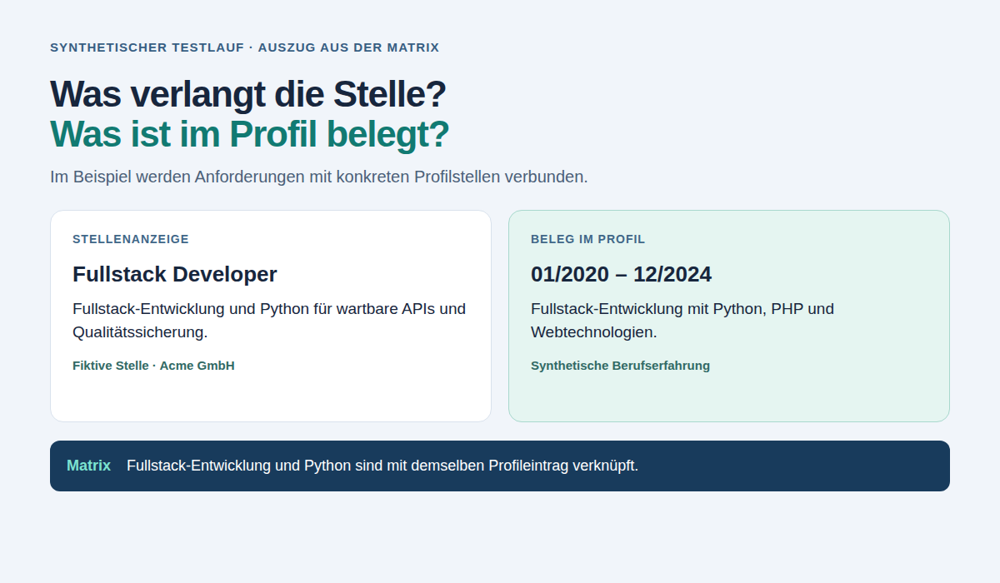
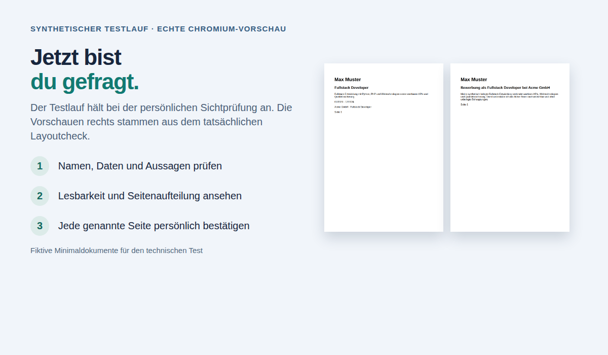
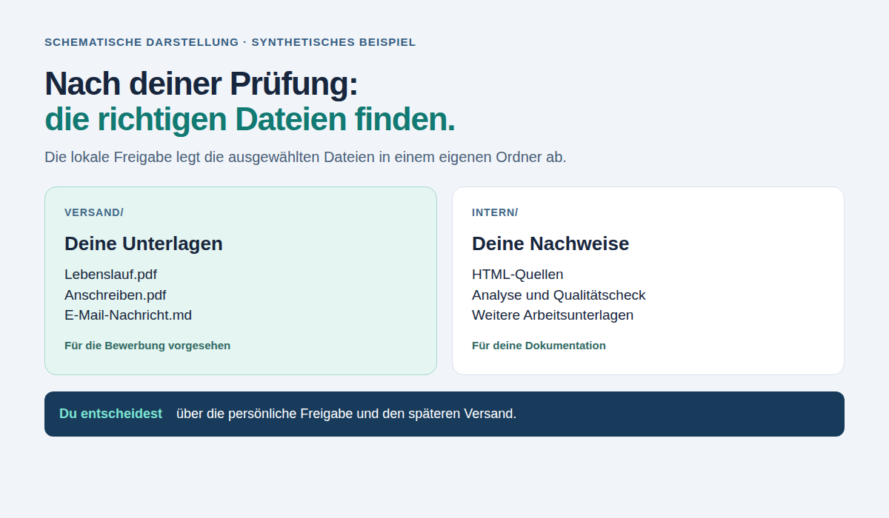
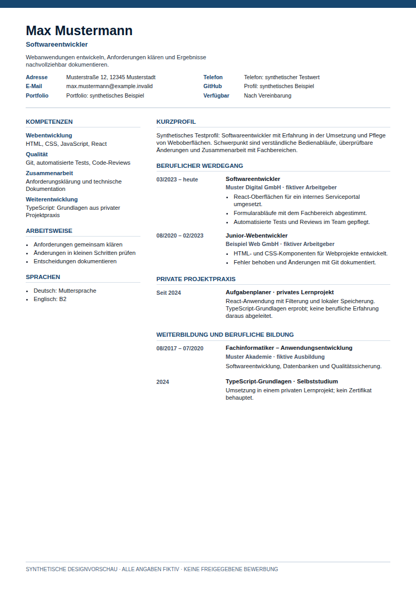
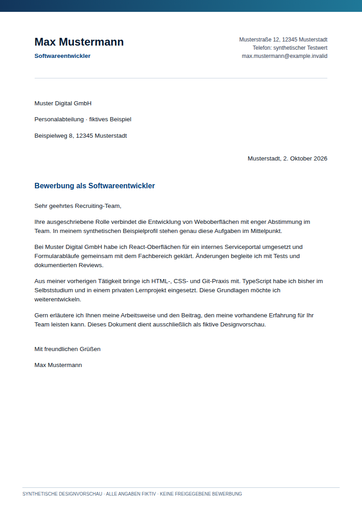
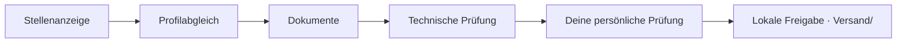

<p align="center">
  
</p>

<h1 align="center">apply-foundry</h1>

<p align="center">
  <strong>Deine Erfahrung. Deine Bewerbung. Deine Entscheidung.</strong><br>
  Ein lokaler Workflow für wahrheitsgemäße, persönlich geprüfte Bewerbungsunterlagen.
</p>

<p align="center">
  <a href="#schnellstart"><strong>Loslegen</strong></a> &nbsp;·&nbsp;
  <a href="#beispiele">Beispiele ansehen</a> &nbsp;·&nbsp;
  <a href="#prozess">Ablauf</a> &nbsp;·&nbsp;
  <a href="#private-daten--datenschutz">Datenschutz</a> &nbsp;·&nbsp;
  <a href="#entwicklung">Entwicklung</a>
</p>

<a id="was-ist-apply-foundry"></a>
<a id="nutzung"></a>

## Von der Stellenanzeige zu deinen Unterlagen

apply-foundry hilft dir, mit einem Coding-Agenten deutsche Bewerbungsunterlagen für deine eigene Bewerbung zu erstellen: einen stellenbezogenen Lebenslauf, ein Anschreiben und auf Wunsch eine E-Mail-Nachricht. Du bringst deine tatsächliche Erfahrung und die Stellenanzeige mit; der Agent führt dich von der Dateneinrichtung bis zu den freigegebenen Dateien.

| 🎯 Stellenbezug | 📄 Dokumente | ✅ Deine Freigabe |
| --- | --- | --- |
| Der Agent gleicht Anforderungen mit deinen belegten Erfahrungen ab. | Je nach Auftrag entstehen Lebenslauf, Anschreiben und E-Mail. | Du prüfst die Vorschauen und bestätigst die lokale Freigabe. |

Das Projekt richtet sich an Bewerber, die einen eingerichteten Coding-Agenten verwenden können. Ein einfacher Chat ohne Datei- und Terminalzugriff reicht dafür nicht. Dateien werden lokal gespeichert; ob dein Agent Eingaben in einer Cloud verarbeitet, hängt von seiner Umgebung ab.

<a id="schnellstart"></a>

## 🚀 Dein Einstieg

**Voraussetzung:** Ein eingerichteter Coding-Agent, der Projektdateien lesen und schreiben, Terminalbefehle ausführen und die Regeln aus `AGENTS.md` berücksichtigen kann. Für die Dokumentprüfung braucht er außerdem PNG-Bildauswertung oder die vorgeschriebene persönliche Alternative. Beispiele sind Codex, Claude Code, Gemini CLI und OpenCode; siehe [Agenten und Nachweisstand](#agenten). Du brauchst außerdem deine Unterlagen und den vollständigen Text der Stellenanzeige.

Aktuell vorgesehen sind **Windows, Linux und Intel-Macs auf x64**. Apple Silicon und andere ARM64-Systeme sind nicht freigegeben. Der Agent prüft Python 3.11+, Chrome/Edge/Chromium und die passende Systemschrift. Fehlende Voraussetzungen installiert er nur nach sichtbarem Plan und bestätigter Berechtigung.

> [!IMPORTANT]
> **Windows 11 und eingeschränkte Agentenumgebungen:** Der automatische PDF-Export kann trotz installiertem Chrome scheitern. Dann ist eine manuelle Fortsetzung in einem normalen lokalen Terminal nötig. Das betrifft nicht nachweislich jede Windows-Installation. [Ursache, Beispiel und Anleitung](#windows-pdf-export).

### 1. Projekt herunterladen

Mit Git:

```bash
git clone https://github.com/Web-Developer-DB/apply-foundry.git
cd apply-foundry
```

Alternativ: [ZIP herunterladen](https://github.com/Web-Developer-DB/apply-foundry/archive/refs/heads/main.zip) und entpacken.

### 2. Projektordner im Agenten öffnen

Öffne den Ordner, in dem `README.md`, `AGENTS.md`, `Prompts/` und `Tools/` liegen. Starte die Agentensitzung dort und gib deinen Auftrag ein.

### 3. Bewerberdaten einrichten

```text
Hilf mir dabei, meine Bewerberdaten für apply-foundry einzurichten.
```

Der Agent prüft zuerst vorhandene Daten, fragt fehlende Angaben ab und nutzt `Private.example/` nur als Strukturvorlage. Prüfe seine Zusammenfassung; bestätige eine dauerhafte Speicherung ausdrücklich.

### 4. Erste Bewerbung starten

```text
Erstelle Lebenslauf, Anschreiben und E-Mail-Nachricht für folgende Stelle:

[vollständiger Text der Stellenanzeige]
```

Damit ist der Umfang eindeutig. Du kannst genauso „nur ein Anschreiben“ oder „Lebenslauf und Anschreiben ohne E-Mail“ beauftragen.

### 5. Vorschauen prüfen und freigeben

Öffne jede vom Agenten genannte Seitenvorschau und prüfe Inhalt, Namen, Zeiträume, Lesbarkeit und Seitenaufteilung. Bestätige danach ausdrücklich die persönliche Prüfung. Bei einer bestätigten reinen E-Mail prüfst du stattdessen die genannte Textdatei.

> [!TIP]
> Im normalen Ablauf verwendest du den Dialog mit deinem Agenten. Er nutzt die Projektwerkzeuge für Profilabgleich und technische Prüfungen. In eingeschränkten Umgebungen kann ein manueller Terminalschritt nötig sein; siehe [Windows und PDF-Export](#windows-pdf-export). Plane Zeit für Rückfragen und deine persönliche Prüfung ein.

<a id="beispiele"></a>

## 👀 Ein Beispiel von Anfang bis Ende

Die folgende Bildfolge zeigt einen **synthetischen Testauftrag** für die fiktive Acme GmbH. Ein Agent hat ein angepasstes Testfixture in einer isolierten Projektkopie ausgeführt. Die Abbildungen erklären den Ablauf; ein interaktiver Agentendialog wurde dabei nicht aufgezeichnet.

### 1 · Auftrag geben

```text
Erstelle Lebenslauf, Anschreiben und E-Mail-Nachricht für die Stelle
als Fullstack Developer. Nutze meine belegten Erfahrungen.
```

Die vollständige Stellenanzeige und dein Profil bilden die Grundlage. Der Agent klärt offene Angaben mit dir.

### 2 · Anforderungen und Belege abgleichen



Die Grafik zeigt zwei Einträge aus der Anforderungsmatrix des Testlaufs. Sie verknüpfen Fullstack-Entwicklung und Python mit einem fiktiven Profileintrag.

### 3 · Jede Seite persönlich prüfen



Der Testlauf hat PDF-Export, Layoutcheck und ATS-Prüfung ausgeführt und bei `bereit_zur_sichtpruefung` angehalten. Die beiden Seiten rechts stammen aus dem Chromium-Layoutcheck. Es sind bewusst einfache Testdokumente. Du kannst sie in Originalgröße öffnen und den Prüfzustand nachvollziehen.

[Lebenslauf-Vorschau öffnen](Tests/Fixtures/Readme/real-run/lebenslauf.png) · [Anschreiben-Vorschau öffnen](Tests/Fixtures/Readme/real-run/anschreiben.png)

### 4 · Freigegebene Dateien finden



Die Ordneransicht ist eine schematische Darstellung des vorgesehenen Ergebnisses. Der gezeigte Testlauf endete vor der persönlichen Freigabe. Nach deiner eigenen Prüfung und ausdrücklichen Bestätigung findest du die ausgewählten Unterlagen unter `Versand/`.

<details>
<summary>Weitere Designvorschauen ansehen</summary>

Diese Vorschauen stammen aus den Designreferenzen und zeigen fiktive Angaben.

| Lebenslauf | Anschreiben |
| --- | --- |
|  |  |

</details>

[Herkunft und Bilderzeugung](Tests/Fixtures/Readme/README.md)

<a id="prozess"></a>

## So funktioniert der Ablauf



**Dein Beitrag** sind die echten Angaben, Antworten auf offene Fragen und die persönliche Prüfung. Der Agent dokumentiert Belege und führt abhängig vom Dokumentumfang die technischen Prüfungen aus. Änderungen nach der Prüfung erfordern neue Nachweise und eine neue persönliche Bestätigung.

Die ATS-Prüfung kontrolliert die Textauslesbarkeit der PDFs. Sie garantiert keine Kompatibilität mit jedem Bewerbermanagementsystem.

<a id="agenten"></a>

## Welche Agenten kann ich verwenden?

Entscheidend sind die Fähigkeiten im geöffneten Projekt: Dateien lesen und schreiben, Terminalbefehle ausführen und Projektregeln beachten. Für HTML-Prüfungen muss der Agent PNGs tatsächlich auswerten können. Fehlt diese Fähigkeit, muss er jede Vorschau benennen und deine persönliche Prüfung verlangen; andere fehlende Fähigkeiten können den Ablauf blockieren.

| Umgebung | Projekteinstieg | Im Repository für Promptregression vorgesehen | Nachweisstand |
| --- | --- | --- | --- |
| OpenAI Codex | `AGENTS.md` | ja | kein gespeicherter vollständiger Modelltestnachweis |
| Claude Code | `CLAUDE.md` verweist auf `AGENTS.md` | ja | kein gespeicherter vollständiger Modelltestnachweis |
| Gemini CLI | `GEMINI.md` bindet `AGENTS.md` ein | ja | kein gespeicherter vollständiger Modelltestnachweis |
| OpenCode | gemeinsame Regeln in `AGENTS.md`; `opencode.json` deaktiviert das Teilen | ja | kein gespeicherter vollständiger Modelltestnachweis |

Diese Einstiege führen in denselben Workflow. Adapter und Testkonfigurationen sind keine Garantie für jede Agenten- oder Modellversion. Andere Agenten sind prinzipiell geeignet, wenn sie die genannten Fähigkeiten und Regeln tatsächlich unterstützen. Agent, Modellzugang, mögliche Abonnements und API-Zugänge richtest du separat ein.

Die automatisierten Python-Vertragstests prüfen die Projektwerkzeuge und Schutzgrenzen; sie sind keine echten Modellsitzungen. [Details zu Architektur und Agenteneinstieg](docs/architecture.md)

<a id="interaktiver-dialog"></a>

## Daten einrichten und Bewerbungen erstellen

Persönliche und fachliche Angaben liegen getrennt unter `Private/Daten/`: Kontaktdaten und Bewerbungslogistik einerseits, Erfahrung, Ausbildung, Kenntnisse und Belege andererseits. Der Agent führt dich durch diese Einrichtung. Kontrolliere insbesondere Zeiträume, Arbeitgeber und die Trennung zwischen Berufserfahrung, Weiterbildung und privater Praxis.

Neue Angaben gelten zunächst nur für den aktuellen Auftrag. Eine dauerhafte Änderung deines Profils braucht einen transparenten Formulierungsvorschlag und deine eindeutige Zustimmung.

### Welche Unterlagen möchtest du?

| Auswahl | Ergebnis |
| --- | --- |
| **A – Komplette Bewerbung** | individueller Lebenslauf, Anschreiben und E-Mail-Nachricht |
| **B – Mit Universal-Lebenslauf** | bereits freigegebener Universal-Lebenslauf unverändert, neues Anschreiben und neue E-Mail-Nachricht |
| **C – Individueller Lebenslauf** | nur ein stellenbezogener Lebenslauf |
| **D – Nur Anschreiben** | nur ein Anschreiben |
| **E – Eigene Zusammenstellung** | ausdrücklich gewählte Kombination |

Du musst keinen Auswahlbuchstaben kennen: Ein eindeutiger Wunsch wird direkt übernommen. Bei einer Stellenanzeige ohne Dokumentwunsch fragt der Agent nach; er ergänzt keine Unterlagen ungefragt. Eine reine E-Mail ohne Anlagen braucht eine gesonderte Bestätigung.

### Andere Einstiege

- **Universal-Lebenslauf:** „Erstelle oder aktualisiere meinen universellen Lebenslauf für Systemadministration.“ Softwareentwicklung und Systemadministration haben eigene freigegebene Fassungen. Sag beim Verwenden in einer Bewerbung dazu, welche Fassung du möchtest.
- **Fortsetzen:** „Setze meine Bewerbung bei [Firma] für [Rolle] fort.“ Der Agent rekonstruiert den Stand aus den Dateien.
- **Daten prüfen:** „Prüfe meine bestehenden Bewerberdaten.“ Vorhandene private Dateien werden nicht ungefragt überschrieben.

<a id="pruefen-und-lokal-freigeben"></a>

## Vorschauen prüfen und lokal freigeben

Der Agent nennt dir die zu prüfenden PNG-Dateien pro A4-Seite. Öffne jede davon und kontrolliere auch fachliche Aussagen: Sind Erfahrungen richtig eingeordnet? Sind alle Angaben wahr? Gibt es abgeschnittene Inhalte oder schlecht lesbare Seiten?

Der Ablauf hält bei `bereit_zur_sichtpruefung`. Erst deine neue eindeutige Bestätigung erlaubt die lokale Freigabe. Eine spätere Änderung entwertet die alte Bestätigung. Auch ein zweiseitiger Lebenslauf muss auf beiden Seiten sinnvoll aufgebaut sein; der Agent behandelt Layoutprobleme vor der Freigabe.

[Technische Freigabeschritte und Layoutregeln](docs/technical-workflow.md)

<a id="ergebnisse"></a>

## Wo liegen die fertigen Dateien?

Nach der persönlichen Prüfung und lokalen Freigabe liegen die ausgewählten Dateien hier:

```text
Private/Bewerbungen/FIRMA/YYYY-MM-DD--ROLLE/
├── Versand/       ← ausgewählte PDFs und gegebenenfalls E-Mail-Text
├── Intern/        ← Quellen und interne Nachweise
└── Manifest.json  ← Nachweis des freigegebenen Dateisatzes
```

> [!IMPORTANT]
> Für deine Bewerbung sind ausschließlich die Dateien aus `Versand/` vorgesehen. Du entscheidest selbst über den Versand. Screenshots, Prüfberichte, HTML-Quellen und `Tokenverbrauch.json` bleiben interne Unterlagen.

[Interne Arbeitsordner, Dateinamen und Nachweise](docs/technical-workflow.md#arbeitsordner-und-ergebnisse)

<a id="private-daten--datenschutz"></a>

## 🔒 Deine Daten und deine Agentenumgebung

- **Getrennte Dateien:** Echte Angaben und Arbeitsergebnisse gehören nur nach `Private/`. `Private.example/` ist eine Strukturvorlage; fiktive Beispielwerte werden nie als deine Daten übernommen.
- **Kein automatischer Versand:** Der Workflow kontaktiert keine Arbeitgeber und lädt keine Unterlagen hoch.
- **Keine privaten Testdaten:** Öffentliche Beispiele und Tests verwenden ausschließlich synthetische Angaben.
- **Git-Schutz mit Grenzen:** `Private/` wird von Git ignoriert. `.gitignore` ist keine Verschlüsselung und schützt weder vor anderen lokalen Programmen noch vor einem bewussten Upload.
- **Agentenumgebung prüfen:** Lokale Dateien bedeuten kein zwingend lokales KI-Modell. Cloudverarbeitung, Aufbewahrung und Nutzung deiner Eingaben hängen vom Agenten und seinen Datenschutz- und Nutzungsbedingungen ab.

Gib keine Passwörter, Bankdaten, Ausweisnummern oder andere unnötige Geheimnisse ein. Prüfe die Kontoeinstellungen deiner Agentenumgebung, bevor du persönliche Daten bereitstellst.

<a id="plattformstatus"></a>

## Plattformen und Voraussetzungen

Der aktuelle Entwicklungsstand unterstützt **Windows x64, Linux x64 und macOS auf Intel x64**. **ARM64 einschließlich Apple Silicon ist derzeit nicht freigegeben.** Vollständige Browserstabilität bleibt Vorschau, bis je Zielprofil drei dokumentierte grüne Läufe vorliegen.

Für HTML-Unterlagen benötigt der Workflow Python 3.11+, Chrome/Edge/Chromium sowie Arial auf Windows, Liberation Sans auf Linux oder eine dieser beiden Schriften auf macOS. Der Agent prüft die Voraussetzungen vor dem Start; du brauchst die einzelnen Werkzeuge im normalen Dialog nicht selbst aufzurufen.

Der historische Release v2.0 hatte einen breiteren Architekturvertrag. Seit dem 28. August 2026 gilt für den aktuellen Stand ausschließlich x64. [Plattformdetails, Setup und Releasehistorie](docs/platform-support.md)

<a id="windows-pdf-export"></a>

## Windows 11: Wenn der automatische PDF-Export scheitert

Apply Foundry verwendet Chrome, Edge oder Chromium, um aus HTML-Unterlagen PDFs und Seitenvorschauen zu erzeugen und das Layout zu prüfen. Ein installierter Browser allein garantiert nicht, dass er auch aus jeder Agentenumgebung gestartet werden kann. Insbesondere unter Windows 11 kann eine eingeschränkte Umgebung den Browserstart blockieren. Dann kann der Agent die technische Vorbereitung nicht vollständig selbst durchführen und du musst sie gegebenenfalls im normalen lokalen Terminal fortsetzen.

**Beobachteter Fall:** Auf einem Windows-11-System war die interne Chrome-Vorprüfung in einer Agentenumgebung mit niedriger Windows-Integritätsstufe fehlgeschlagen. Derselbe Vorprüfungsaufruf war zuvor im normalen PowerShell-Terminal erfolgreich. Das deutet auf einen Unterschied der Ausführungskontexte hin; die genaue Ursache ist damit nicht bewiesen. Dieses Ergebnis bedeutet weder, dass Windows 11 grundsätzlich nicht unterstützt wird, noch, dass jeder Fehler dieselbe Ursache hat.

Die folgende Ausgabe ist eine **schematische Fehlermeldung zur Orientierung**, kein Screenshot und kein vollständiges Fehlerprotokoll:

```text
Browser-Vorprüfung fehlgeschlagen.
Kein ausgewählter Browser konnte die A4-Testseite drucken.
PDF-Browserlauf endete mit Exitcode 4294930433:
TransactNamedPipe: Die Pipe wurde beendet. (0x6D)
crash server failed to launch, self-terminating
```

### So setzt du eine Bewerbung manuell fort

1. Bitte den Agenten, den Fehler und den **genauen privaten Arbeitsordner** der betroffenen Bewerbung zu nennen. Er soll prüfen, ob Auftrag, Kandidaten und erforderliche Nachweise für die technische Vorbereitung vollständig sind. Beispielpfade sind keine echten Arbeitsordner.
2. Öffne ein normales PowerShell-Terminal über das Windows-Startmenü und wechsle in deinen Projektordner:

   ```powershell
   Set-Location "C:\Pfad\zu\apply-foundry"
   ```

3. Bitte den Agenten um den für deine Bewerbung passenden vollständigen Befehl. Der folgende Aufruf zeigt die Form für eine **normale Bewerbung**. Ersetze den Beispielpfad durch den tatsächlich genannten Arbeitsordner und verwende gegebenenfalls den vom Agenten ermittelten Python-Aufruf:

   ```powershell
   py -3 Tools/bewerbung.py finalisieren --arbeitsordner "Private/Bewerbungen/FIRMA/_Arbeitsdateien/YYYY-MM-DD--ROLLE" --browser auto
   ```

   `py -3` setzt den Windows-Python-Launcher mit Python 3.11 oder neuer voraus. Falls er nicht verfügbar ist, verwende den vollständigen Pfad zu einer geeigneten `python.exe`; der Agent kann ihn anhand der Voraussetzungen ermitteln. Ein universeller Lebenslauf hat einen eigenen Ablauf mit `universal-finalisieren` und seinem eigenen Arbeitsordner: Lass dir dafür den passenden Befehl nennen.
4. Führe den Befehl aus und achte auf die Ausgabe. Die technische Vorbereitung erstellt bei Erfolg die erforderlichen Prüfberichte und Vorschauen. Sie veröffentlicht die Bewerbung mit diesem Aufruf noch nicht. Tritt erneut ein Fehler auf, gib dem Agenten die genaue Fehlermeldung; entferne dabei gegebenenfalls persönliche Daten und private Pfade.
5. Bitte den Agenten, den Zustand aus den vorhandenen Projektdateien zu prüfen und fortzusetzen. Öffne **jede** genannte PNG-Vorschau, prüfe Inhalt und Gestaltung und bestätige deine persönliche Prüfung erst danach ausdrücklich. Erst anschließend darf der Agent den vorgesehenen lokalen Freigabeprozess durchführen. Für den Versand sind ausschließlich Dateien im freigegebenen Ordner `Versand/` vorgesehen.

Änderungen an Quellen oder Kandidaten nach der Prüfung erfordern eine erneute technische Vorbereitung und persönliche Bestätigung. Den Browser-Sandboxschutz oder Windows-Sicherheitseinstellungen musst du für diesen Ablauf nicht deaktivieren. Der manuelle Weg ist keine Erfolgsgarantie: Wenn auch das normale Terminal scheitert, müssen Browser, Voraussetzungen und genaue Fehlermeldung gesondert untersucht werden.

<a id="hilfe"></a>

## Häufige Probleme

| Frage oder Problem | Nächster Schritt |
| --- | --- |
| Muss ich die technischen Kommandos kennen? | Normalerweise bedient der Agent die Werkzeuge. Bei eingeschränktem Browserstart kann ein [manueller Terminalschritt](#windows-pdf-export) nötig sein. |
| Unter Windows 11 scheitert der PDF-Export im Agenten | [Fehler und manuelle Fortsetzung](#windows-pdf-export) prüfen; ein installiertes Chrome genügt nicht immer. |
| Python, Browser oder Schrift fehlen | Der Agent zeigt den Setupplan und nennt Voraussetzungen. Installationen brauchen bestätigte Berechtigung. |
| Ich verwende einen Apple-Silicon-Mac oder ARM64-Rechner | Dieser aktuelle Stand ist dafür nicht freigegeben; siehe Plattformdetails. |
| Agent oder Browser kann nicht auf Dateien zugreifen | Lass die fehlende Fähigkeit konkret benennen; ohne erforderliche Nachweise kann keine Freigabe erfolgen. |
| Screenshots sind vorhanden, aber noch keine fertigen Dateien | Prüfe alle genannten Seiten persönlich und bestätige die Prüfung ausdrücklich. |
| Ein Layoutproblem blockiert den Ablauf | Der Agent überarbeitet belegte Inhalte und Seitenaufteilung; danach prüfst du neue Vorschauen. |
| Erfahrung, Zeitraum oder Zertifikat ist unklar | Angabe klären oder als offene Frage dokumentieren; nichts erfinden. |
| Nach einer Änderung fehlt die Freigabe | Erwartetes Verhalten: neuer Prüflauf und neue persönliche Bestätigung. |

<a id="verantwortung"></a>

## Verantwortungsvolle Nutzung

Strategische Positionierung bedeutet, wahre und belegbare Erfahrungen auszuwählen, zu gewichten und stellenrelevant zu formulieren. Ziel ist ein zutreffendes und ausgewogenes Bild für den Recruiter. Erfundene Identitäten, Arbeitgeber, Tätigkeiten, Projekte, Abschlüsse, Zertifikate, Kenntnisse oder Zeiträume sind unzulässig. Ebenso unzulässig sind irreführende Umdeutungen oder bewusst täuschende Auslassungen.

Das Projekt unterstützt die eigene Bewerbung. Es ist nicht für Arbeitgeberbewertung, Ranking, Filterung oder Auswahl von Bewerbern vorgesehen. Technische Prüfung und KI-Unterstützung garantieren weder fachliche Wahrheit oder Vollständigkeit noch eine Einladung oder Einstellung. Du prüfst und verantwortest die Unterlagen vor ihrer Verwendung.

<a id="eu-ai-act"></a>

### EU AI Act

Die ausführliche [EU-AI-Act-Einordnung](docs/legal/eu-ai-act.md) beschreibt Zweckgrenzen, Rollen, Transparenzpflichten und rechtliche Grenzen mit Quellen und Datumsstand. Sie ist keine Rechtsberatung, Konformitätserklärung oder Zertifizierung.

<a id="entwicklung"></a>

## 🧰 Für Entwickler und technisch Interessierte

Der Produktivkern verwendet Python 3.11+ und die Standardbibliothek. Der verbindliche Agenteneinstieg ist [AGENTS.md](AGENTS.md); der kanonische Bewerbungsworkflow steht in [Prompts/00_AGENTEN_START_HIER.md](Prompts/00_AGENTEN_START_HIER.md).

| Vertiefung | Inhalt |
| --- | --- |
| [Architektur und Entwicklung](docs/architecture.md) | Agenteneinstieg, Promptmodule, Python-Kern, Tests und CI |
| [Technischer Workflow](docs/technical-workflow.md) | Dateiverträge, Prüfungen, Hashbindung, Freigabe und Layout-Gates |
| [Plattformunterstützung](docs/platform-support.md) | aktuelle Grenzen, Paketwege, Setup und historische Einordnung |
| [Console-App-Roadmap](docs/console-app.md) | Konzept einer optionalen Terminaloberfläche, nicht implementiert |

Browserfreie Prüfung, nach dem read-only Setupplan:

```bash
python3 Tools/setup.py --all --dry-run --format json
python3 -m unittest discover -s Tests/Python -p 'test_*.py'
python3 Tools/bewerbung.py tests --suite vollstaendig
```

[CHANGELOG.md](CHANGELOG.md) dokumentiert Änderungen. Für technische Arbeit gelten weiterhin alle privaten Pfadgrenzen und persönlichen Freigabegates.

<a id="lizenz"></a>

## Lizenz

apply-foundry steht unter der [MIT-Lizenz](LICENSE).
